  <picture>
    <source media="(max-width: 480px)" srcset="./assets/volyx-terminal-mobile.svg" />
    
  </picture>

  <strong>AI Engineer building reliable RAG, multimodal, and voice systems in Python.</strong>

  <a href="https://joshua-nwachinemere.pages.dev">Portfolio</a> ·
  <a href="https://www.linkedin.com/in/joshua-nwachinemere/">LinkedIn</a> ·
  <a href="https://orcid.org/0009-0000-7388-3586">ORCID</a> ·
  <a href="mailto:joshua0nwachinemere@gmail.com">Email</a>

## What I build

I build the retrieval, context, evaluation, and backend reliability layers that turn model capability into systems people can inspect and control.

- **Applied AI:** grounded retrieval, multimodal inputs, voice workflows, structured outputs, and measurable evaluations
- **Reliable services:** async Python, FastAPI, retries, caching, webhooks, and idempotent workflows
- **Product systems:** privacy-aware desktop apps, provider routing, explicit control boundaries, and automated verification

## Featured work

### [Volyx Lens](https://volyxlens.pages.dev/)

A cross-platform AI assistant for screen, voice, and meeting context. You choose what it can see, capture starts only when you ask, and keys stay in the main process. macOS, Windows, and Linux.

[Product](https://volyxlens.pages.dev/) · [Source](https://github.com/dk3yyyy/volyx-lens)

### [Local Review Intelligence](https://github.com/dk3yyyy/local_AI_agent)

Local-first RAG with adaptable CSV mapping, recoverable indexes, validated citations, and a measured semantic-vs-BM25 evaluation.

[Source](https://github.com/dk3yyyy/local_AI_agent) · [Architecture](https://github.com/dk3yyyy/local_AI_agent/blob/main/docs/architecture.md) · [Results](https://github.com/dk3yyyy/local_AI_agent/tree/main/evaluation/results/v0.2.0-ollama-0.32.5)

### [Football Forecasting Lab](https://github.com/dk3yyyy/football_predictor)

Leakage-resistant temporal ML evaluation with calibrated models, frozen holdouts, and a fair comparison against bookmaker odds.

[Source](https://github.com/dk3yyyy/football_predictor) · [Evaluation](https://github.com/dk3yyyy/football_predictor#verified-evaluation-snapshot)

More selected work

### [Career Ops](https://github.com/dk3yyyy/career-ops-hermes)

Hermes-first local job-search operations: role discovery, evidence-backed applications, tracking, and interview preparation.

[Source](https://github.com/dk3yyyy/career-ops-hermes)

### [Evidence-First Article Pipeline](https://github.com/dk3yyyy/evidence-first-article-pipeline)

A workflow and CLI for researched, illustrated, agent-assisted technical articles, with citations checked before publication.

[Source](https://github.com/dk3yyyy/evidence-first-article-pipeline)

## Open-source work

Thirteen merged upstream contributions across nine projects, grouped by how they improve agent reliability, evaluation, tracing, and framework compatibility:

- **[OpenAI Agents SDK #3991](https://github.com/openai/openai-agents-python/pull/3991):** bounded retry behavior for retryable pre-response WebSocket failures
- **[Pydantic AI Harness #503](https://github.com/pydantic/pydantic-ai-harness/pull/503):** preserved model retry context after host-side Code Mode session resets
- **[Mellea #1471](https://github.com/generative-computing/mellea/pull/1471):** deterministic tracing coverage for async spans, context propagation, and token usage
- **[FastStream #2961](https://github.com/ag2ai/faststream/pull/2961):** FastAPI 0.140 compatibility with preserved AsyncAPI metadata

View nine additional merged contributions

- **[FastStream #2984](https://github.com/ag2ai/faststream/pull/2984):** stop handler exceptions leaking under AnyIO
- **[FastStream #2976](https://github.com/ag2ai/faststream/pull/2976):** consume existing Redis entries in new consumer groups
- **[Pydantic AI Harness #520](https://github.com/pydantic/pydantic-ai-harness/pull/520):** decode URL-safe binary media payloads
- **[Mellea #1469](https://github.com/generative-computing/mellea/pull/1469):** stop generation workers on stream timeout
- **[Microsoft Agent Framework #7391](https://github.com/microsoft/agent-framework/pull/7391):** ignore excluded tool results during Python compaction
- [Apache Arrow Rust #10486](https://github.com/apache/arrow-rs/pull/10486)
- [Altair #4089](https://github.com/vega/altair/pull/4089)
- [FastStream FastAPI #2](https://github.com/faststream-community/faststream_fastapi/pull/2)
- [Calkit #1028](https://github.com/calkit/calkit/pull/1028)

## Tools

**Primary:** Python, FastAPI, asyncio, Ollama, Chroma, scikit-learn, XGBoost 
**Product and delivery:** Electron, Swift, React, Docker, GitHub Actions, Playwright, n8n, Azure AI Foundry

## Current

Building VolyxAI and Volyx Lens. Open to AI Engineer and ML Engineer opportunities.

[joshua0nwachinemere@gmail.com](mailto:joshua0nwachinemere@gmail.com)
